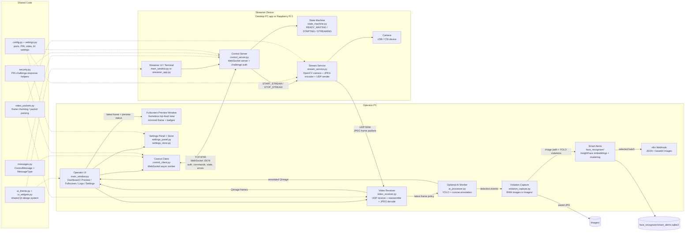

# SkyGuard Architecture

## 1. Diagram Interpretation

Source flow: `flow_charts.md`

The diagram describes an operator-driven streamer system:

1. The streamer PC application starts.
2. It enters `READY_WAITING` mode.
3. The operator PC enters streamer IP address and a 4-digit password/PIN.
4. The operator sends `START_STREAM`.
5. The streamer receives the command while waiting.
6. Only then does the streamer initialize the camera, encode frames, and begin video transmission.
7. The operator UI displays the incoming stream.
8. The operator can send `STOP_STREAM`.
9. `STOP_STREAM` returns the streamer to `READY_WAITING`.

Important correction from the flow: streamer launch is not the same as stream start. Camera access, frame encoding, and video transport must remain stopped until an authenticated `START_STREAM` command is accepted.

## 2. Recommended High-Level Architecture

Build two desktop applications from one shared Python codebase:

- `streamer/`: runs on the streamer PC, exposes a control server, owns camera capture and video sending.
- `operator/`: runs on the operator PC, connects to streamer by IP/PIN, sends commands, receives video, displays status.
- `shared`: protocol schemas, message types, state enums, logging, security helpers, common config.

Use a separated control plane and media plane:

- Control channel: authenticated command/status messaging.
- Video channel: low-latency unidirectional media stream.

Recommended protocols:

- Control channel: WebSocket over TLS when possible, using JSON or MessagePack messages.
- Video channel for LAN low latency: RTP/UDP carrying H.264 or H.265.
- Future scalable option: WebRTC for NAT traversal, congestion control, encryption, and browser/client extensibility.

Current implementation:

- Current MVP: `WebSocket control + OpenCV JPEG-over-UDP video`.
- Next media upgrade: `WebSocket control + RTP/UDP H.264 via GStreamer`.
- Future scalable product: `WebSocket signaling + WebRTC media`.

### System Architecture Diagram



## 3. Folder Structure

```text
SkyGuard/
  .gitignore
  README.md
  ARCHITECTURE.md
  flow_charts.md
  pyproject.toml
  requirements.txt
  requirements-ai-common.txt
  requirements-ai-cpu.txt
  requirements-ai-cuda.txt
  run_streamer.py
  run_operator.py
  shared/
    __init__.py
    config.py
    constants.py
    messages.py
    network.py
    security.py
    settings.py
    state.py
    ui_theme.py
    ui_tokens.py
    ui_widgets.py
    video_packets.py
  streamer/
    __init__.py
    app.py
    main_window.py
    control_server.py
    state_machine.py
    services/
      __init__.py
      stream_service.py
  operator/
    ai_environment.py
    ai_processor.py
    app.py
    main_window.py
    control_client.py
    settings_panel.py
    settings_store.py
    video_receiver.py
    violation_capture.py
  face_recognizer/
    __init__.py
    embeddings.py
    clustering.py
    store.py
    n8n_sender.py
    smart_alert_service.py
    smart_alerts.sqlite3
  Images/
```

Note: `operator/` intentionally has no `__init__.py` because `operator` is also a Python standard-library module. `run_operator.py` runs it by path and `operator/app.py` adds the needed import paths.

## 4. Module Responsibilities

### Shared

- `messages.py`: typed command/status schemas such as `START_STREAM`, `STOP_STREAM`, `AUTH`, `HEARTBEAT`, `STREAM_STARTED`, `STREAM_STOPPED`, `ERROR`.
- `state.py`: application state enums and valid transitions.
- `security.py`: PIN hashing, token creation, challenge response, rate limiting helpers.
- `network.py`: parses operator connection addresses and discovers local LAN IPv4 addresses.
- `settings.py`: shared AI/video settings dataclasses, defaults, serialization, and validation.
- `ui_tokens.py`: centralized light/dark design tokens for colors, surfaces, borders, text, status badges, and hover states.
- `ui_theme.py`: `ThemeManager` that applies QFluentWidgets theme mode/color, global QSS, and refreshes registered themed widgets.
- `ui_widgets.py`: reusable themed widgets such as `AcrylicGlowFrame` and `ThemedStatusBadge`.
- `video_packets.py`: packetizes JPEG frames into small UDP packets and parses them on receive.
- `config.py`: control/video ports, default hosts, and PIN settings.

### Streamer

- `app.py`: PySide6 application bootstrap.
- `main_window.py`: local streamer status UI. It should show ready/streaming/error state but should not auto-start the stream.
- `control_server.py`: WebSocket control server. Authenticates operator and receives commands.
- `state_machine.py`: source of truth for streamer lifecycle.
- `stream_service.py`: opens camera only after `START_STREAM`, encodes frames as JPEG using OpenCV, and sends them on the separate UDP video channel.

### Operator

- `main_window.py`: QFluentWidgets shell with navigation, preview toolbar, and fullscreen preview window.
- `control_client.py`: authenticated WebSocket client.
- `settings_panel.py`: operator Settings page for AI and video controls.
- `settings_store.py`: local `%APPDATA%\SkyGuard\operator_settings.json` persistence.
- `ai_environment.py`: inspects the active Python environment from a subprocess and builds detached installer commands for CPU/CUDA AI setup.
- `ai_processor.py`: optional operator-side YOLO processing with lazy heavy imports.
- `video_receiver.py`: receives JPEG-over-UDP video packets, reassembles frames, decodes them with OpenCV, and emits `QImage` frames to the preview.
- `violation_capture.py`: optional RAW violation image capture policy and file naming for saved images.

### AI Layer

- `AI_layer/improved.py`: reusable YOLO frame processor adapted from the old local-camera demo. It preserves class names, violation color rules, `cvzone` box/text rendering, and FPS overlay, but no longer opens a camera or loads YOLO at import time.
- `AI_layer/yolo/*.pt`: local YOLO model files selected by the operator settings.

## 5. UI Architecture

Use PySide6 with QFluentWidgets for a Windows 11 Fluent-style desktop UI.

Main window pattern:

- `FluentWindow` or `MSFluentWindow`
- Sidebar navigation
- Top status area
- Central stacked views
- Bottom log/status strip

Current operator navigation:

- Dashboard
- Preview
- Logs
- Settings

Current streamer navigation:

- Status
- Logs

Required UI states:

- Disconnected
- Connecting
- Authenticated
- Ready
- Starting
- Streaming
- Stopping
- Error

Operator controls:

- Connect/disconnect
- Start stream
- Stop stream
- Full screen preview
- AI Environment refresh
- Install CPU AI
- Install CUDA AI
- Retry
- Mute preview audio if audio is added later
- Snapshot/recording can be future optional controls

Visual requirements:

- Dark/light mode with QFluentWidgets theme support.
- Custom light/dark design tokens owned by `shared/ui_tokens.py`.
- `ThemeManager` as the only place that applies the QFluentWidgets theme color and shared application QSS.
- Opaque premium cards via `AcrylicGlowFrame`, with custom `paintEvent` rendering for surfaces, borders, subtle shadows, and restrained hover overlays.
- A visually distinct Settings `Customize` card for runtime `Auto` / `Light` / `Dark` theme switching.
- Solid window/page backgrounds are used for readability and smooth repaint performance.
- Modern sidebar navigation.
- Clear status badges for control channel and video channel.
- Stream preview pane with loading, no-signal, live, and error overlays.
- Fullscreen stream preview with the same aspect-ratio rendering, stream settings badge, RAW/AI badge, AI status, and alert count.
- Real-time logs with timestamp, source, severity, and message.
- Responsive layouts using Qt splitters and stretch factors.
- Operator pages are wrapped in scroll areas so Settings and Preview remain usable on smaller windows.
- The operator default window is intentionally shorter, with scrollable content instead of vertically stretched controls.
- The fullscreen preview is a separate frameless top-level widget and can be closed from its toolbar or with `Esc`/`F11`.

### Theme And Design Tokens

The UI style is centralized so feature code does not own raw colors:

```text
QApplication
  -> ThemeManager.initialize(app, "auto")
  -> QFluentWidgets Theme.AUTO + theme color
  -> global QSS for logs, controls, and scrollbars
  -> registered widgets receive apply_theme(tokens)
```

Current token files:

- `shared/ui_tokens.py`
  - Light: background `#F0F8FF`, primary `#2196F3`, border `#D3D3D3`, secondary text `#757575`.
  - Dark: background `#0B1220`, surface `#122033`, border `rgba(144, 202, 249, 0.14)`, primary highlight `#90CAF9`, primary text `#D6E2F0`, secondary text `#93A4B7`.
  - Badge colors for waiting, success, error, and offline states.
- `shared/ui_theme.py`
  - `ThemeManager.initialize(app, "auto" | "light" | "dark")`
  - `ThemeManager.set_preference(...)` for runtime theme switching.
  - `preview_stylesheet()`, `scroll_area_stylesheet()`, and `status_badge_stylesheet(...)`.
- `shared/ui_widgets.py`
  - `ThemedPage` for page-level theme refresh hooks.
  - `ThemedStatusBadge` for semantic state badges.
  - `AcrylicGlowFrame` for cards/panels with stable surfaces and restrained hover states.
  - `CustomizeCard` for runtime theme selection in Settings.

QSS is used for stable, declarative styling such as log surfaces, controls, and scrollbars. Custom widgets use `QPainter` and `QPainterPath` for card surfaces, borders, and the transparent hover overlay.

### Operator Settings Page

The Settings page contains four logical areas:

- `AI Environment`: reports Python executable, PyTorch version, backend, CUDA availability, GPU name, whether `ultralytics`/`cvzone`/`insightface`/`onnxruntime` are installed, and the active ONNX Runtime providers. It can launch CPU or CUDA installers in a separate PowerShell window.
- `AI Detection`: enables/disables inference and selects model, device, confidence, IoU, image size, and verbosity.
- `Video Settings`: selects camera index, resolution, FPS, and JPEG quality sent to the streamer inside `START_STREAM`.
- `Smart Alerts`: enables InsightFace-based face grouping, batch interval, max selected images, similarity threshold, summary sending, temp record pruning, and the n8n webhook URL.

The Settings page is lazy-loaded when first opened, and AI environment inspection runs only when the user clicks `Refresh`. Inspection runs in a separate Python process via `QProcess`. The GUI process does not import `torch` for environment checks, which avoids locking PyTorch DLLs before a backend switch and keeps startup/navigation smooth.

### Smart Alerts Face Recognition Layer

Smart Alerts does not replace the YOLO violation detector and does not capture images by itself. It starts after `violation_capture.py` saves a RAW violation image under `Images/`.

Pipeline:

1. `OperatorMainWindow._handle_ai_detection()` receives YOLO class counts and the saved image path.
2. `SmartAlertService.record_candidate()` queues the image path, violations, summary, and timestamp.
3. `FaceEmbeddingExtractor` uses InsightFace (`buffalo_l` by default, override with `SKYGUARD_INSIGHTFACE_MODEL`) to detect real faces and create normalized embeddings.
4. `SmartAlertStore` writes records into `face_recognizer/smart_alerts.sqlite3` without changing the schema for old records.
5. `cluster_observations()` groups pending observations by cosine similarity and violation type.
6. `select_top_groups()` keeps the best representative images.
7. `N8nSender` sends one JSON payload to the configured webhook, embedding selected images as base64.

Provider policy:

- New observations use provider `insightface`.
- OpenCV Haar and image-level fallback embeddings are disabled for new records.
- Legacy records with older providers can still be read so existing SQLite data does not break.

## 6. Network Architecture

### Control Channel

Use a persistent WebSocket connection:

- Default port: `8765`
- Transport: TCP
- Encoding: JSON for easy debugging, MessagePack later if needed
- Security: challenge response using a PIN-derived secret

Example commands:

```json
{"type":"AUTH_REQUEST","client_id":"operator-01"}
{"type":"AUTH_RESPONSE","pin_proof":"..."}
{"type":"START_STREAM","request_id":"...","video_port":5004,"video_settings":{"camera_index":0,"width":640,"height":360,"fps":60,"jpeg_quality":65}}
{"type":"STOP_STREAM","request_id":"..."}
{"type":"HEARTBEAT","timestamp":...}
```

Example statuses:

```json
{"type":"STATE","state":"READY_WAITING"}
{"type":"STATE","state":"STARTING"}
{"type":"STATE","state":"STREAMING","fps":60,"bitrate_kbps":6000}
{"type":"STATE","state":"READY_WAITING"}
{"type":"ERROR","code":"CAMERA_OPEN_FAILED","message":"Camera unavailable"}
```

### Video Channel

Current LAN MVP:

- JPEG frames over UDP
- Default UDP port: `5004`
- `shared/video_packets.py` chunks each encoded frame into small UDP packets.
- This is intentionally simple and useful for development, but it is not the final production media transport.

Recommended production upgrade:

- Streamer: camera source -> optional OpenCV processing -> hardware encoder -> RTP payloader -> UDP sink
- Operator: UDP source -> RTP depayloader -> decoder -> Qt preview sink

Future scalable version:

- WebRTC media channel
- WebSocket remains as signaling/control channel
- DTLS/SRTP encryption built in
- Better NAT and network adaptation

## 7. Threading and Async Model

Use Qt as the UI owner and isolate blocking work.

Recommended model:

- Main Qt thread: UI only.
- Async control worker: WebSocket server/client using `asyncio`.
- Streamer media worker thread: camera capture, JPEG encode, UDP send.
- Operator media worker thread: UDP receive, frame reassembly, JPEG decode, Qt signal emit.
- Current optional AI worker: operator-side YOLO inference with a latest-frame policy.
- AI environment probe: short-lived subprocess that prints JSON status.
- AI installers: detached PowerShell processes so package replacement is not performed inside the GUI process.

Integration choices:

- Use `qasync` to integrate `asyncio` with PySide6 when practical.
- Use `QThread` or `QRunnable` for media workers that interact with Qt signals.
- Use bounded queues between capture, processing, and encoding to prevent latency buildup.
Current code uses normal Python threads for the media sender/receiver and Qt signals for UI updates.

Latency rule:

- Prefer dropping old frames over buffering when the operator is behind.
- If AI is enabled but still loading, preview continues in RAW mode until the model is ready.
- The AI worker stores only the latest submitted frame. New frames replace older unprocessed frames.

## 8. AI Architecture

AI is operator-only and optional.

### Runtime Flow

1. The operator receives frames from the UDP video channel.
2. If AI is disabled, the raw `QImage` is rendered immediately.
3. If AI is enabled but not ready, raw video continues rendering while the model loads.
4. When AI is ready, received frames are submitted to the AI worker.
5. The AI worker keeps only the latest frame and drops older pending frames.
6. The worker converts `QImage -> RGB numpy -> BGR numpy`.
7. `ImprovedYoloFrameProcessor` runs YOLO inference and draws boxes/text with `cvzone`.
8. The annotated BGR frame is converted back to RGB and emitted to the UI.

### AI States

Current user-facing states:

- `Disabled`: AI disabled in settings.
- `Loading`: worker started and dependencies/model are loading.
- `Ready`: model warmed up and accepting frames.
- `Missing dependencies`: optional AI packages are not installed.
- `Model error`: model file missing or inference/load failed.

Preview badges use:

- `RAW`: raw video path.
- `AI ON`: inference path active.
- `AI ERROR`: dependency, model, or runtime failure.

### Lazy Loading

Heavy AI imports are performed only inside the AI worker thread after AI is enabled:

- `cv2`
- `cvzone`
- `numpy`
- `torch`
- `ultralytics.YOLO`

This keeps the base operator app usable without AI dependencies and prevents Torch from loading unless the operator asks for inference.

### Models

The operator discovers model files from:

```text
AI_layer/yolo/*.pt
```

Current known models:

- `light_2.6k.pt`
- `medium_2.6k.pt`

Recommended defaults:

- CPU: `light_2.6k.pt`, `imgsz=320`, `device=cpu` or `auto`.
- CUDA: `light_2.6k.pt` or `medium_2.6k.pt`, `imgsz=320`, `device=auto` or `cuda`.

### CPU/CUDA Environment Switching

CPU and CUDA PyTorch builds are mutually exclusive in the same `.venv` because they install the same package names:

- `torch`
- `torchvision`
- `torchaudio`

The setup scripts uninstall those packages before installing the requested backend.

Current installer split:

- `setup_ai_cpu.ps1`: installs PyTorch from `https://download.pytorch.org/whl/cpu`, installs `requirements-ai-cpu.txt`, then shared packages from `requirements-ai-common.txt`.
- `setup_ai_cuda.ps1`: installs PyTorch from `https://download.pytorch.org/whl/cu128`, installs `requirements-ai-cuda.txt`, then shared packages from `requirements-ai-common.txt`.
- `requirements-ai-cpu.txt`: `onnxruntime` for CPU InsightFace execution.
- `requirements-ai-cuda.txt`: `onnxruntime-gpu` for GPU InsightFace execution when `CUDAExecutionProvider` is available.
- `requirements-ai-common.txt`: `ultralytics`, `cvzone`, `pillow`, `PyYAML`, `lap`, and `insightface`.

The CUDA installer verifies:

- Torch imports successfully.
- `torch.__version__` does not contain `+cpu`.
- `torch.cuda.is_available()` is true.
- The CUDA device name can be printed.
- InsightFace imports successfully.
- ONNX Runtime providers can be printed. If `CUDAExecutionProvider` is unavailable, YOLO can still use CUDA but InsightFace Smart Alerts will fall back to CPU.

If any of those checks fail, the CUDA installer exits with failure and does not claim setup is complete.

Before changing PyTorch backend, the installer checks for running Python processes from:

```text
.venv\Scripts\python.exe
```

If one is found, the installer asks the user to close the operator app and any project Python terminals before continuing. This avoids locked DLLs and pip leftovers such as `~orch` or `~orchvision`.

## 9. State Management Logic

Streamer state machine:

```text
BOOTING
  -> READY_WAITING

READY_WAITING
  authenticated START_STREAM -> STARTING

STARTING
  camera_ok + video_sender_ok -> STREAMING
  failure -> ERROR

STREAMING
  STOP_STREAM -> STOPPING
  media_failure -> ERROR
  control_disconnect -> policy decision

STOPPING
  cleanup_done -> READY_WAITING

ERROR
  reset/cleanup_done -> READY_WAITING
```

Rules:

- Application launch must end in `READY_WAITING`, not `STREAMING`.
- Authentication happens on the WebSocket control channel before start/stop commands are accepted.
- `START_STREAM` is ignored unless state is `READY_WAITING`.
- Camera capture and frame encoding are initialized only in `STARTING`.
- `STOP_STREAM` is accepted in `STARTING` or `STREAMING`.
- Cleanup must release camera, sockets, and worker threads.
- State changes must be emitted to both local UI and authenticated operator UI.

Suggested streamer API:

```python
async def start_stream(target: StreamTarget) -> None:
    if state.current != StreamerState.READY_WAITING:
        return

    state.transition(StreamerState.STARTING)
    try:
        await stream_service.start(target)
    except Exception as exc:
        await stream_service.stop()
        state.transition(StreamerState.ERROR, reason=str(exc))
        state.transition(StreamerState.READY_WAITING)
        raise

    state.transition(StreamerState.STREAMING)

async def stop_stream() -> None:
    if state.current not in {StreamerState.STARTING, StreamerState.STREAMING}:
        return

    state.transition(StreamerState.STOPPING)
    await stream_service.stop()
    state.transition(StreamerState.READY_WAITING)
```

## 10. Streaming Lifecycle

### Streamer Startup

1. Load config.
2. Start UI.
3. Start control server.
4. Show `READY_WAITING`.
5. Do not open camera.
6. Do not encode or transmit frames.
7. Do not transmit video.

### Operator Start Flow

1. Operator enters IP and 4-digit PIN.
2. Operator connects to streamer control channel.
3. Operator authenticates.
4. Operator sends `START_STREAM` with requested media parameters.
5. Streamer validates state and auth.
6. Operator starts the UDP video receiver on port `5004`.
7. Streamer opens camera.
8. Streamer encodes frames as JPEG.
9. Streamer sends video packets over UDP.
10. Operator reassembles, decodes, and displays frames.

### Stop Flow

1. Operator sends `STOP_STREAM`.
2. Streamer transitions to `STOPPING`.
3. Streamer stops UDP sender.
4. Streamer releases camera.
5. Streamer returns to `READY_WAITING`.
6. Operator stops UDP receiver.
7. Operator preview shows ready/no-signal state.

## 11. Security Considerations

Baseline:

- Do not send the 4-digit PIN in plain text.
- Use challenge-response authentication.
- Current MVP derives the PIN key with PBKDF2-HMAC-SHA256.
- For production, use Argon2 or bcrypt for stored PIN/password material.
- Rate-limit failed PIN attempts.
- Lock out temporarily after repeated failures.
- Bind to LAN interface by default.
- Allow an explicit trusted IP allowlist.
- Add session tokens after authentication before production use.
- Log all connect, auth, start, stop, and failure events.

Important note:

A 4-digit PIN is convenient but weak. For production, combine it with pairing:

- First-run pairing code shown on streamer PC.
- Operator stores a trusted client key after pairing.
- Later sessions use PIN plus client key, or client certificate.

For WebRTC:

- Use DTLS/SRTP for encrypted media.
- Keep WebSocket signaling over TLS if crossing machines outside a trusted LAN.

## 12. Recommended Libraries

UI:

- `PySide6`
- `PySide6-Fluent-Widgets` / `qfluentwidgets`
- `qasync` for a future unified Qt/asyncio event loop

Control channel:

- `websockets`
- `pydantic` for future typed message validation
- `orjson` for future faster JSON, or standard `json`

Streaming:

- `opencv-python`
- `numpy`
- `GStreamer` via `PyGObject` for the planned H.264/RTP upgrade
- `aiortc` for future WebRTC
- `PyAV` where future direct FFmpeg frame handling is useful

Encoding:

- Hardware H.264/H.265 encoder through GStreamer when available:
  - NVIDIA: NVENC
  - Intel: Quick Sync
  - AMD: AMF where available
- Software fallback: x264 low-latency preset

AI future integration:

- `ultralytics`
- `cvzone`
- `insightface`
- `onnxruntime-gpu` or `onnxruntime`
- `torch` only if needed by the selected model path

Packaging:

- `pyinstaller` or `nuitka`
- `ruff`
- `pytest`
- `pytest-qt`

## 13. Production Improvements Over the Diagram

Recommended improvements:

- Add explicit authentication before `START_STREAM`.
- Add a heartbeat so both apps detect disconnects.
- Add clear error recovery path from `ERROR` to `READY_WAITING`.
- Add stream parameter negotiation before video starts.
- Add separate status reporting for control connected, authenticated, media starting, and media live.
- Add a pairing flow instead of relying only on a 4-digit PIN.
- Add a policy for operator disconnect while streaming:
  - Safer default: stop stream after heartbeat timeout.
  - Optional advanced mode: continue streaming for a short grace period.

Unclear part in the diagram:

- `E --> B` means the `START_STREAM` command is sent to the waiting streamer state. It should not mean the streamer loops forever in waiting. The proper interpretation is: while in `READY_WAITING`, the streamer accepts `START_STREAM`, then transitions into camera/video startup.

## 14. Suggested MVP Build Order

1. Shared message schemas and state enum.
2. Streamer window that starts in `READY_WAITING`.
3. Streamer WebSocket control server with authentication.
4. Operator window with IP/PIN connect view.
5. Operator start/stop commands and status display.
6. OpenCV camera lifecycle that proves camera is not opened until `START_STREAM`.
7. JPEG-over-UDP video sender and receiver.
8. Operator video preview with fixed-size responsive scaling and fullscreen viewing.
9. Logs and basic error recovery.
10. Operator Settings page for AI and video settings.
11. Operator-side YOLO processing hook.
12. Next: GStreamer RTP/H.264 pipeline.
13. Next: health metrics and reconnect.

