# SkyGuard Flow Charts

This document collects the main runtime flows for the SkyGuard operator/streamer system.
The important architectural rule is unchanged: streamer startup is not stream startup.
The streamer must stay in `READY_WAITING` and must not open the camera, encode frames,
or transmit video until an authenticated `START_STREAM` command is accepted.

## 1. End-to-End System Flow

```mermaid
flowchart TD
    A["Start SkyGuard"] --> B{"Which app starts?"}

    B -- "Streamer desktop" --> S1["Create QApplication"]
    B -- "Raspberry Pi streamer" --> R1["Start terminal app"]
    B -- "Operator desktop" --> O1["Create QApplication"]

    S1 --> S2["ThemeManager.initialize(auto)"]
    S2 --> S3["Build StreamerMainWindow<br/>Status + Logs"]
    S3 --> S4["Load StreamerConfig from env<br/>host, control port, video port, PIN"]
    S4 --> S5["Create StreamerStateMachine"]
    S5 --> S6["Create StreamService"]
    S6 --> S7["Start StreamerControlServer<br/>background asyncio thread"]
    S7 --> S_READY["READY_WAITING<br/>camera closed, UDP stopped"]

    R1 --> R2["Load StreamerConfig from env"]
    R2 --> R3["Create StateMachine + StreamService + ControlServer"]
    R3 --> R4["Print listening address and video port"]
    R4 --> S_READY

    O1 --> O2["ThemeManager.initialize(auto)"]
    O2 --> O3["Build OperatorMainWindow<br/>Dashboard / Preview / Logs / Settings"]
    O3 --> O4["Load OperatorSettingsStore<br/>APPDATA SkyGuard, legacy fallback"]
    O4 --> O5["Create VideoReceiver<br/>Create AiProcessor<br/>Create ViolationCaptureManager"]
    O5 --> O6["Operator enters streamer address + 4 digit PIN"]

    O6 --> C1["Parse ControlEndpoint"]
    C1 --> C2["Start OperatorControlClient<br/>background asyncio thread"]
    C2 --> C3["Open WebSocket to streamer<br/>TCP 8765 by default"]
    C3 --> C4["Challenge-response authentication"]
    C4 --> C5{"Auth OK?"}

    C5 -- "No" --> C_ERR["Connection ERROR<br/>log auth failure"]
    C_ERR --> O6
    C5 -- "Yes" --> C_OK["AUTHENTICATED"]
    C_OK --> C_STATE["Streamer sends STATE"]
    S_READY --> C_STATE

    C_STATE --> O_START{"Operator clicks Start Stream?"}
    O_START -- "No" --> C_STATE
    O_START -- "Yes" --> M1["Operator starts local UDP receiver<br/>0.0.0.0:5004 by default"]
    M1 --> M2["Send START_STREAM<br/>payload: video_port + video_settings"]
    M2 --> M3["Streamer validates state<br/>READY_WAITING only"]
    M3 --> M4["Streamer enters STARTING"]
    M4 --> M5["Open camera only now"]
    M5 --> M6["Encode frames as JPEG"]
    M6 --> M7["Chunk frames with video_packets.py"]
    M7 --> M8["Send UDP packets to operator host:port"]
    M8 --> M9["Streamer enters STREAMING"]
    M9 --> M10["Operator reassembles UDP packets"]
    M10 --> M11["Decode JPEG to QImage"]
    M11 --> M12{"AI enabled and ready?"}
    M12 -- "No" --> M_RAW["Render RAW preview"]
    M12 -- "Yes" --> M_AI["Submit latest frame to AI worker"]
    M_AI --> M_AI2["YOLO inference + cvzone drawing"]
    M_AI2 --> M_AI3["Render annotated preview"]
    M_RAW --> M_SYNC["Update preview badges<br/>mirror to fullscreen if open"]
    M_AI3 --> M_SYNC
    M_AI2 --> M_VIOL{"Violation capture enabled?"}
    M_VIOL -- "No" --> M_LOOP["Continue receiving frames"]
    M_VIOL -- "Yes" --> M_SAVE{"Violation + face policy passes?"}
    M_SAVE -- "No" --> M_LOOP
    M_SAVE -- "Yes" --> M_IMG["Save RAW JPG in Images/"]
    M_IMG --> M_SMART{"Smart Alerts enabled?"}
    M_SMART -- "Yes" --> M_QUEUE["Queue image path + YOLO violations<br/>for Smart Alerts"]
    M_SMART -- "No" --> M_LOOP
    M_QUEUE --> M_LOOP
    M_SYNC --> M_LOOP
    M_LOOP --> O_STOP{"STOP_STREAM or close app?"}
    O_STOP -- "No" --> M10
    O_STOP -- "STOP_STREAM" --> STOP1["Operator sends STOP_STREAM"]
    STOP1 --> STOP2["Operator stops UDP receiver"]
    STOP2 --> STOP3["Streamer enters STOPPING"]
    STOP3 --> STOP4["Stop sender thread<br/>release camera and UDP socket"]
    STOP4 --> S_READY
    O_STOP -- "Close" --> SHUTDOWN["Stop AI, video receiver, control client/server"]
```

## 2. Control Channel, Authentication, and Command Flow

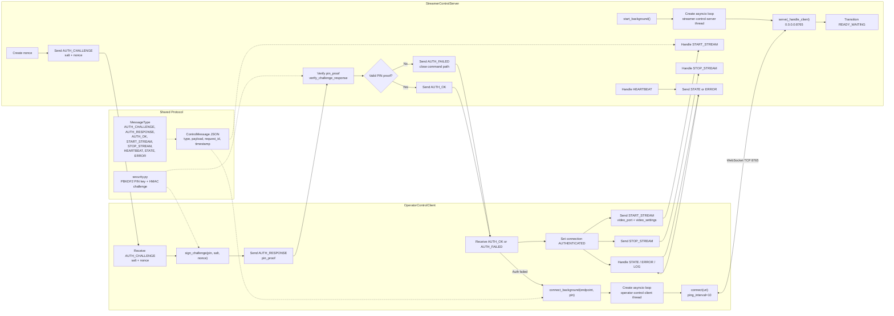

## 3. Streamer Lifecycle and State Machine Flow

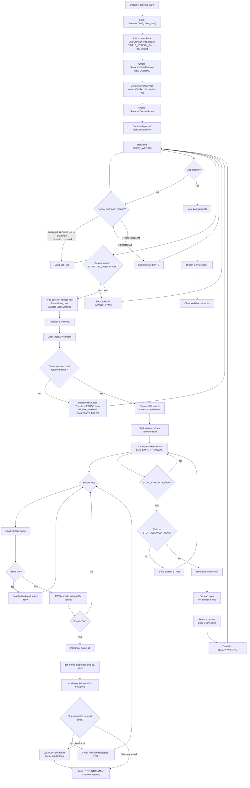

## 4. Operator UI, Connection, and Preview Flow

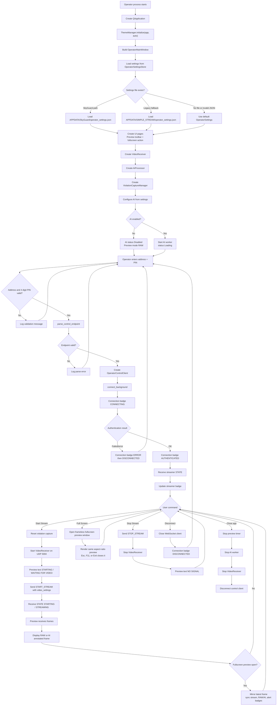

## 5. Video Transport and Frame Reassembly Flow

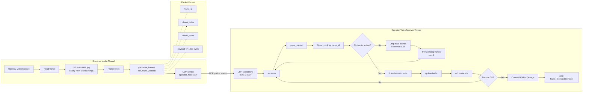

## 6. Operator Frame, AI, and Violation Capture Flow

```mermaid
flowchart TD
    A["VideoReceiver emits raw QImage"] --> B["_handle_received_frame(image)"]
    B --> C{"AI setting enabled<br/>and AiProcessor ready?"}

    C -- "No" --> D["Display raw frame"]
    D --> E["Preview badge RAW"]
    E --> F["Violation badge Alerts 0"]
    F --> G["Render timer paints aspect-ratio preview label"]
    G --> G1{"Fullscreen preview visible?"}
    G1 -- "No" --> G2["Return to receive loop"]
    G1 -- "Yes" --> G3["Set same QImage on fullscreen label"]
    G3 --> G2

    C -- "Yes" --> H["submit_frame(image)"]
    H --> I["AI worker stores latest frame only"]
    I --> J["Older pending frame is replaced"]
    J --> K["Worker wakes on frame_event"]
    K --> L["Convert QImage to BGR numpy"]
    L --> M["ImprovedYoloFrameProcessor.predict"]
    M --> N["Ultralytics YOLO inference"]
    N --> O["cvzone boxes/text + FPS overlay"]
    O --> P["Compute class_counts<br/>violation_count<br/>violation_summary"]
    P --> Q["Emit metrics<br/>AI ON | ms | FPS"]
    Q --> R["Emit violations_changed"]
    R --> S{"Detection events enabled?"}
    S -- "No" --> T["Emit annotated QImage"]
    S -- "Yes" --> U["Emit detection_processed<br/>raw image + counts + summary"]

    U --> V["ViolationCaptureManager.consider"]
    V --> W{"Capture enabled?"}
    W -- "No" --> T
    W -- "Yes" --> X{"Face count > 0<br/>and NO-Mask/NO-Helmet/NO-Safety Vest?"}
    X -- "No" --> Y["Mark inactive<br/>maybe reset after stabilization"]
    Y --> T
    X -- "Yes" --> Z{"Same face count as last capture?"}
    Z -- "Yes" --> T
    Z -- "No" --> AA{"Stabilization elapsed?"}
    AA -- "No" --> AB["Store pending face count"]
    AB --> T
    AA -- "Yes" --> AC["Save RAW JPG<br/>Images/timestamp_facesN_summary_raw.jpg"]
    AC --> T

    T --> AD["Convert annotated BGR to QImage"]
    AD --> AE["frame_processed signal"]
    AE --> AF["_display_frame"]
    AF --> G

    subgraph AI_LOAD["AI Load and Failure Paths"]
        L1["configure(AiSettings)"]
        L2{"settings.enabled?"}
        L3["Stop old worker<br/>status Disabled<br/>metrics RAW"]
        L4["Start worker<br/>status Loading"]
        L5["Import cv2, cvzone, numpy, torch, ultralytics"]
        L6{"Imports OK?"}
        L7["status Missing dependencies<br/>metrics AI ERROR"]
        L8["Resolve model path<br/>AI_layer/yolo/*.pt"]
        L9{"Model exists?"}
        L10["status Model error<br/>metrics AI ERROR"]
        L11["Resolve device auto/cpu/cuda<br/>load YOLO model<br/>warm up"]
        L12{"Model load OK?"}
        L13["status Ready<br/>metrics AI ON"]
        L14["status Model error<br/>metrics AI ERROR"]
    end

    L1 --> L2
    L2 -- "No" --> L3
    L2 -- "Yes" --> L4 --> L5 --> L6
    L6 -- "No" --> L7
    L6 -- "Yes" --> L8 --> L9
    L9 -- "No" --> L10
    L9 -- "Yes" --> L11 --> L12
    L12 -- "Yes" --> L13
    L12 -- "No" --> L14
    L13 -.->|"ready gate"| C
```

## 7. Smart Alerts InsightFace Batch Flow

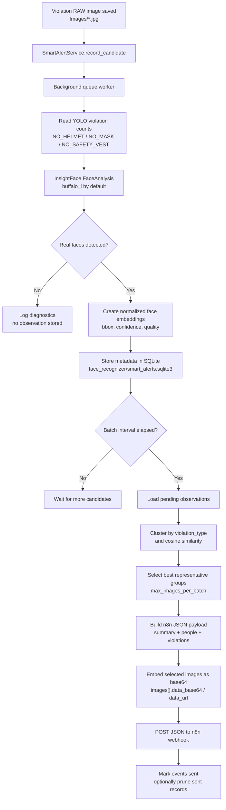

Diagnostics format:

```text
Smart Alerts diagnostics | Image: X | Provider: insightface | Faces detected: N | Embeddings created: N
```

## 8. Settings, Persistence, and Live Stream Restart Flow

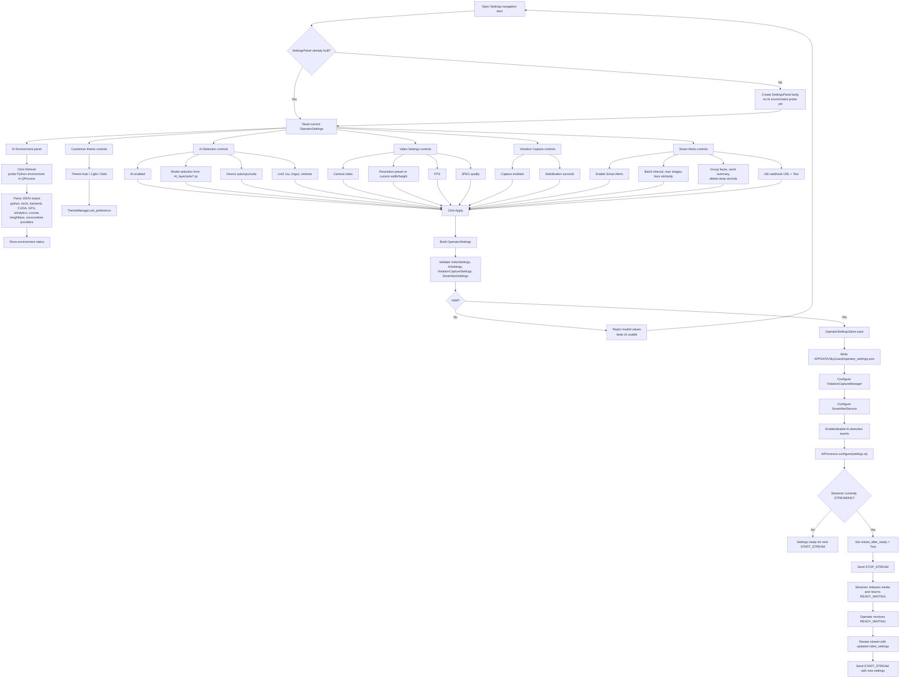

## 9. AI Environment Installer Flow

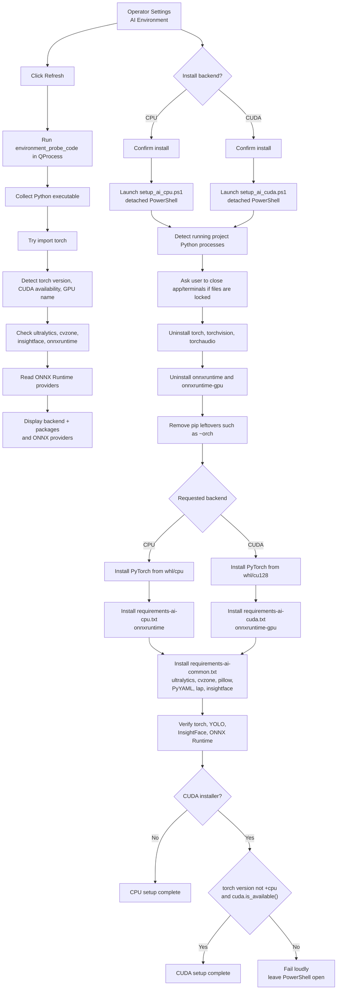

## 10. UI Theme and Shared Design Flow

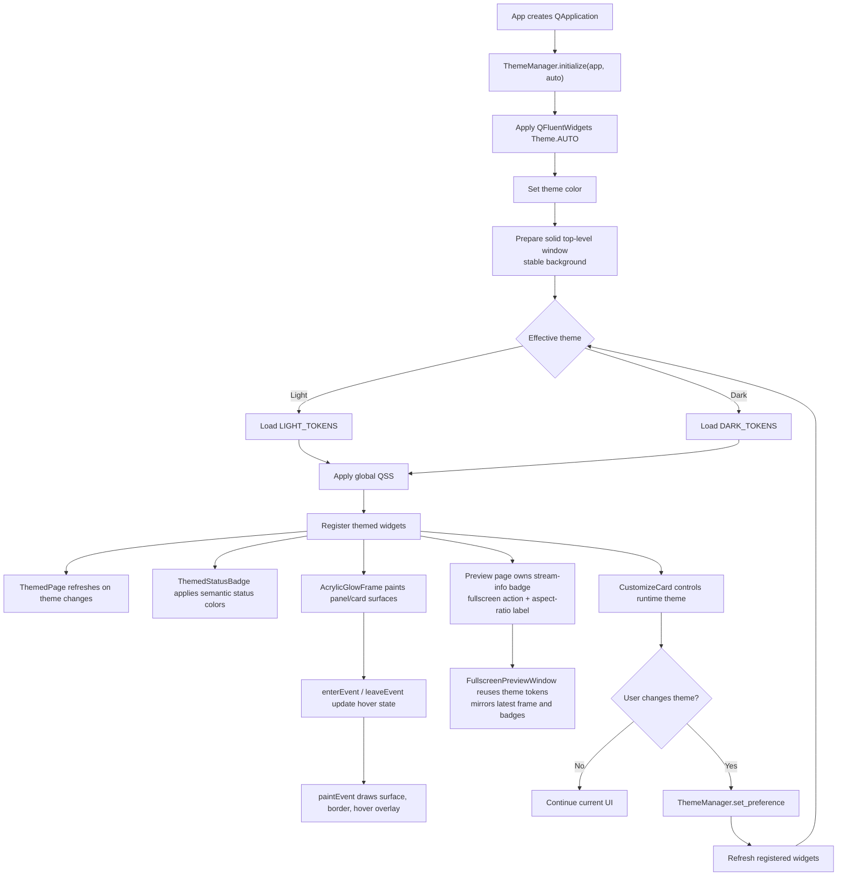

## 11. Error, Disconnect, and Shutdown Flow

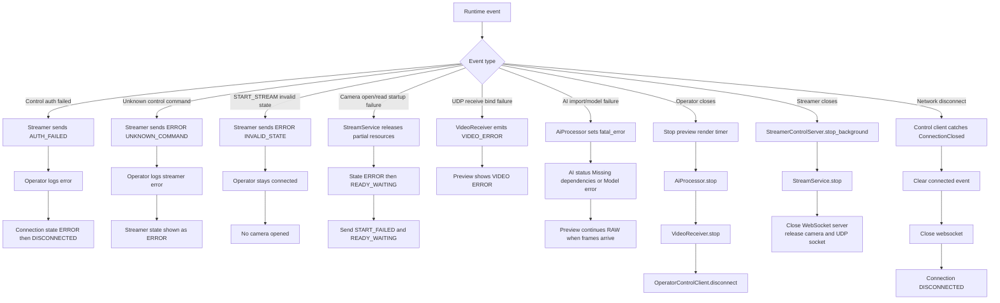

## 12. Deployment Target Flow

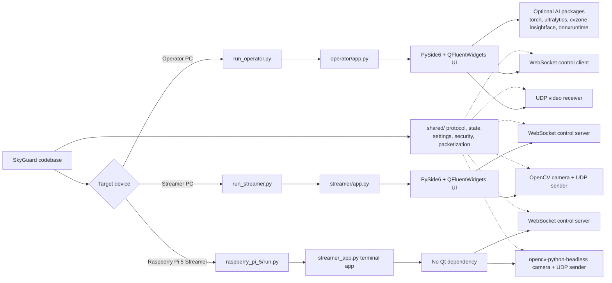
